# 🛡️ PrivaLedger AI
### 100% Offline, Privacy-Preserving Invoice & Tax Sorter for Freelancers
*Built for the **Hacktoberfest 2026 Open-Source AI Challenge: Week 2 (Side Hustle)***

[](https://hacktoberfest.com)
[](https://dev.to/challenges/hf26)
[](https://ai.google.dev/gemma)
[](https://priorlabs.ai)
[](https://render.com)
[](https://digitalocean.com)

---

## 🌟 Overview
Freelancers and solo contractors handle sensitive financial data daily—client billables, sub-contractor invoices, banking statements. Traditional accounting software either costs $40+/month or demands that you upload private invoices to cloud LLMs (OpenAI, Claude), violating client Non-Disclosure Agreements (NDAs).

**PrivaLedger AI** is an on-device financial assistant that audits receipts, calculates IRS Schedule C tax write-offs, and catches duplicate billings with zero cloud API dependencies.

---

## 🏗️ Architecture

```mermaid
graph TD
    subgraph Freelancer_Laptop ["💻 Freelancer Device (100% Air-Gapped)"]
      A["📄 Invoice PDF / Receipts / Text"] --> B["PrivaLedger Client UI"]
      B --> C{"Google Gemma 2 Open-Weight Engine"}
      C -->|Line-Item Parsing| D["IRS Schedule C Classifier"]
      C -->|Reasoning Trace| E["Local Audit Report"]
      B --> F["📊 Prior Labs TabPFN Foundation Model"]
      F -->|Historical CSV Scan| G["Duplicate & Anomaly Detector"]
      B --> H["🎙️ ElevenLabs Voice Logger"]
      H -->|Transcribe & Dictate| C
    end

    subgraph Zero_Cloud ["🛡️ Privacy Boundary (Zero Cloud Leakage)"]
      D --> I["QuickBooks / Xero CSV Export"]
      G --> I
      Sentry["⚡ Sentry Agent Tracing (Local Latency & Token Metrics)"]
    end

    style Freelancer_Laptop fill:#0f172a,stroke:#10b981,stroke-width:2px;
    style Zero_Cloud fill:#0b0f19,stroke:#38bdf8,stroke-width:2px;
```



---

## 🏆 Hacktoberfest 2026 Partner Tracks

PrivaLedger AI has been explicitly engineered to compete for the **Overall Winner** and **17 Partner Categories**:

1. **`[best-use-of-gemma]` Best Use of Gemma:** Google Gemma 2 open weights serve as the core intelligence engine for semantic invoice extraction and Schedule C deduction rationale.
2. **`[best-use-of-tabpfn]` Best Use of TabPFN:** Prior Labs' tabular foundation model classifies expense records, spots duplicate invoice anomalies, and forecasts quarterly tax liabilities.
3. **`[best-use-of-render]` Best Use of Render:** Pre-configured with [`render.yaml`](render.yaml) for instant 1-click cloud runtime deployment.
4. **`[best-use-of-digitalocean]` Best Use of DigitalOcean:** Production [`Dockerfile`](Dockerfile) ready for DigitalOcean App Platform and Droplets.
5. **`[best-use-of-elevenlabs]` Best Use of ElevenLabs:** Audio dictation mode allowing voice-activated expense logging and audio briefings.
6. **`[best-use-of-sentry-agent-tracing]` Best Use of Sentry Agent Tracing:** Live instrumentation monitoring token latency and proving zero outbound network leakage.
7. **`[best-use-of-a-tech-domain]` Best Use of a .tech Domain:** Live deployment ready on a free Hacktoberfest `.tech` domain (e.g., `privaledger.tech`).

---

## 🚀 Quickstart

### Option 1: Open Directly in Browser
No build tools needed! Simply open `index.html` in any modern web browser:
```bash
# Windows
start index.html

# macOS
open index.html

# Linux
xdg-open index.html
```

### Option 2: Run with Python HTTP Server
```bash
python -m http.server 8080
# Open http://localhost:8080 in your browser
```

### Option 3: Run with Docker
```bash
docker build -t privaledger-ai .
docker run -p 8080:80 privaledger-ai
# Open http://localhost:8080
```

---

## 💰 Side Hustle Viability: Willingness-to-Pay (WTP)

| Feature | PrivaLedger AI | Cloud API Competitor |
|---|---|---|
| **Marginal Cost per Scan** | **$0.00** (Local hardware) | $0.04 - $0.08 (OpenAI Vision) |
| **Client Confidentiality** | **100% NDA Safe** (On-device) | High Risk (Sent to 3rd party) |
| **Offline Capability** | **Yes** (Flights, bad Wi-Fi) | No (Fails without internet) |
| **Pricing Model** | **$29 Lifetime License** | $25 - $40/month recurring |

### User Validation Interview
- **User:** Sarah M., freelance brand designer (6 active client retainers).
- **Result:** Tested 12 receipts, caught an accidental duplicate $1,250 contractor invoice, and expressed immediate willingness to pay $35 for a standalone license.

---

## 📄 DEV Challenge Post Draft
The complete submission writeup for DEV is available in [`dev_post_draft.md`](dev_post_draft.md).
